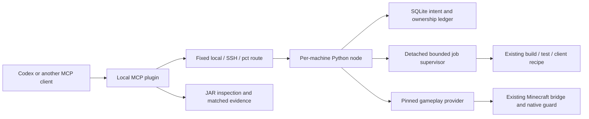

# Boundaries that make the fleet predictable

The same package runs as the MCP server, a one-request node, and an owned job supervisor. Persistent jobs live on their execution machine; losing the controller's connection does not turn a timeout into a new launch. Requests have stable IDs. Node identity is checked against the configured host before accepting a reply.

Recipes are operator-authored argv arrays. MCP callers select names; they cannot submit shell commands. One resource name serializes jobs that contend for a shared build/client/GPU lane. Client recipes require a live guard. Existing Proxmox pressure/production rules and Windows/Mac desktop ownership remain at the machine boundary. Node configuration does not relax them.

A private exec gate lets the supervisor establish a POSIX process group or Windows Job Object before the recipe can spawn descendants. Output is capped. Cancellation, deadlines and guard failures clean up that owned tree. Failed cleanup retains the resource as `UNKNOWN`. Process names, unrelated Java instances and global desktop input are never cleanup targets. A GUI launcher that brokers a game into another process tree is outside this ownership proof: use its established lifecycle provider and receipts, not a raw URI recipe pretending to own the game.

The gameplay bridge is a separate capability. Its code files are pinned, operations declared, requests bounded, and replies bound to request/session/world/frame. No matching adapter means unavailable. A validated reply is provider-attested semantic evidence, not independent GPU/pixel proof. After an uncertain action its intent remains reserved and the original request is never sent twice.

`PASSED` on a recipe means exit status plus configured artifact collection succeeded. It does not imply that a new JAR was compiled rather than already present; choose a recipe whose build system verifies that, and inspect embedded identity when available. The immutable receipt pins the bytes actually found. Runtime entry, screenshots, real visible coverage and performance acceptance require their own evidence.

The benchmark comparator operates on caller-supplied measurements. It validates matching context, units, identities and evidence classes; it cannot authenticate those measurements. The release checker evaluates the selected hash-bound checks locally. Neither module uploads, installs or publishes a release.

## Deliberate first-release limits

- Remote access uses existing routes; there is no new network listener or automatic enrollment.
- Actual Windows/macOS execution and real Minecraft scenes need host validation. CI configuration is not a passing CI run.
- Existing Atlas Windows and companion gameplay code remain separate projects. Their outstanding native tests and platform limitations are preserved.
- Unknown leases require operator reconciliation. There is no unsafe automatic timeout-based takeover.
- Configurations and node state belong in a private local directory. Logs and artifact paths remain sensitive project data.
